<div align="center">

# ▌TURBO BUTTON

**Press the button. Fix the PC.**

A portable repair agent for computer technicians. Run it on the customer's PC from a USB stick, scan the QR code with your phone, and work through the scan, the plan and the fixes with an AI (or without one). You approve every change, and it cleans up after itself when you're done.

[](https://github.com/flesheatingbug/Turbo-Button/actions/workflows/build.yml)


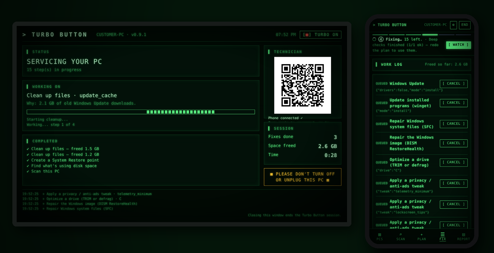

### ⬇ Downloads

[**TurboButton.apk**](https://github.com/flesheatingbug/Turbo-Button/releases/download/latest/TurboButton.apk) (phone) ·
[**TurboButton.exe**](https://github.com/flesheatingbug/Turbo-Button/releases/download/latest/TurboButton.exe) (Windows) ·
[**TurboButton-x86_64.AppImage**](https://github.com/flesheatingbug/Turbo-Button/releases/download/latest/TurboButton-x86_64.AppImage) (Linux)

<sub>All files: <a href="https://github.com/flesheatingbug/Turbo-Button/releases/tag/latest">Latest build</a> · rebuilt automatically on every change</sub>

</div>

---

## Contents

- [How it works](#how-it-works)
- [See it in action](#see-it-in-action)
- [Quick start](#quick-start)
- [What it checks and fixes](#what-it-checks-and-fixes)
- [AI options (free ones too)](#ai-options-free-ones-too)
- [Safety](#safety)
- [Handy extras](#handy-extras)
- [Building it yourself](#building-it-yourself)
- [Troubleshooting](#troubleshooting)

---

## How it works

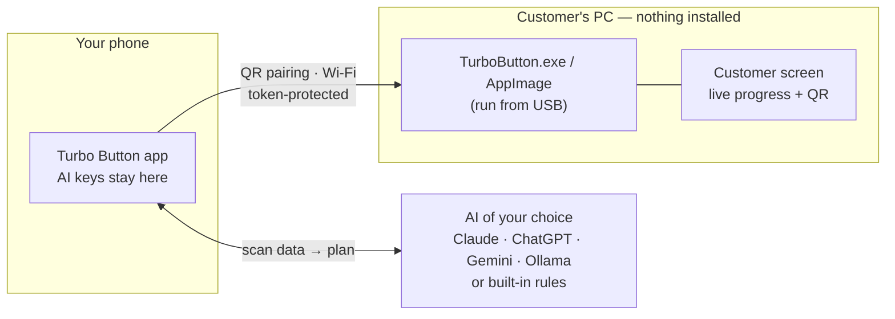

1. **Run** the agent on the customer's PC. It asks for admin rights, shows a QR code and opens a full-screen customer view.
2. **Scan** the QR code with the app. The PC scans itself automatically (read-only).
3. **Plan.** Tap **Quick plan** (built-in rules, no AI), or send the scan to an AI. You get findings and a list of proposed fixes.
4. **Fix.** Tick the fixes you approve and press Run. A restore point is made first, and the customer watches each step on their screen.
5. **Report.** Rescan for the before → after numbers, write the report (AI or basic) and share it.
6. **End.** The agent closes and removes everything it put on the PC.

Your AI keys never touch the customer's PC: they live encrypted on your phone.

---

## See it in action

<table>
<tr>
<td align="center" width="38%">
<br>
<sub><b>On your phone:</b> connect → scan → Quick plan → approve → fix → report</sub>
</td>
<td align="center">
<br>
<sub><b>On the customer's PC:</b> what's being done and why, live</sub>
</td>
</tr>
</table>

<details open>
<summary><b>Screenshots</b></summary>
<br>

| Connect | Scan | Plan |
|:---:|:---:|:---:|
| 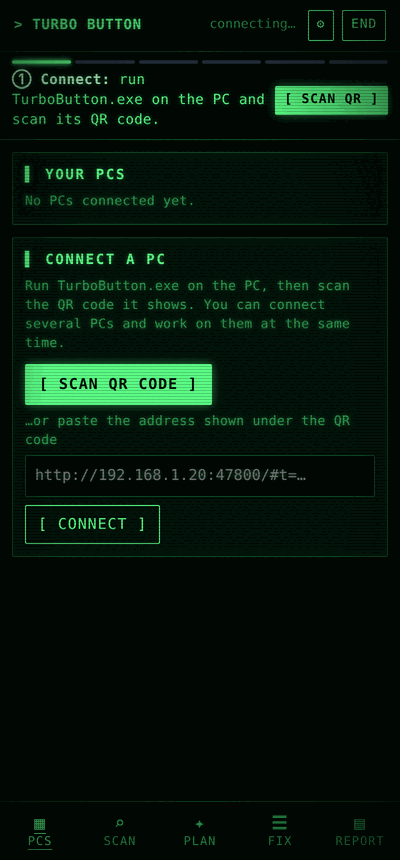 | 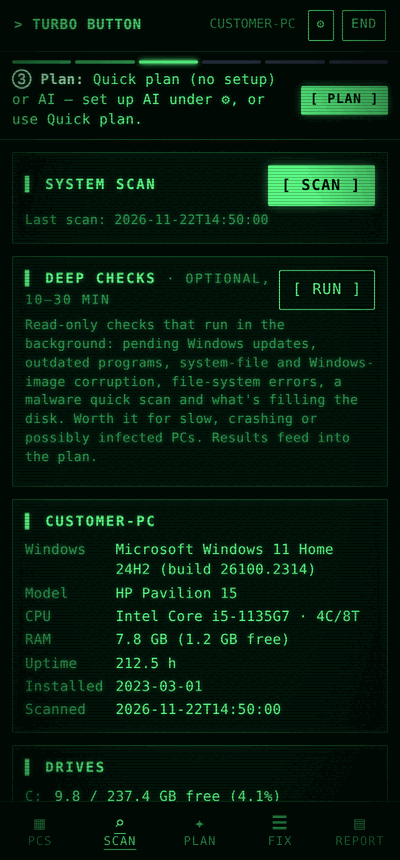 | 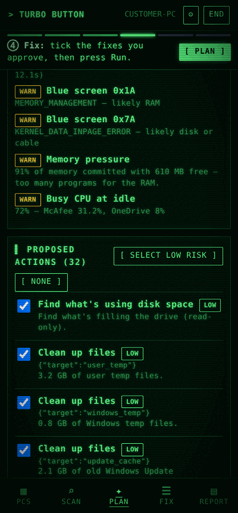 |
| Scan the QR code on the PC. Connect as many PCs as you like. | Hardware, health, security, junk, startup, hijacks… | Findings plus proposed fixes. Tick what you approve. |

| Fix | Before → After | Report |
|:---:|:---:|:---:|
| 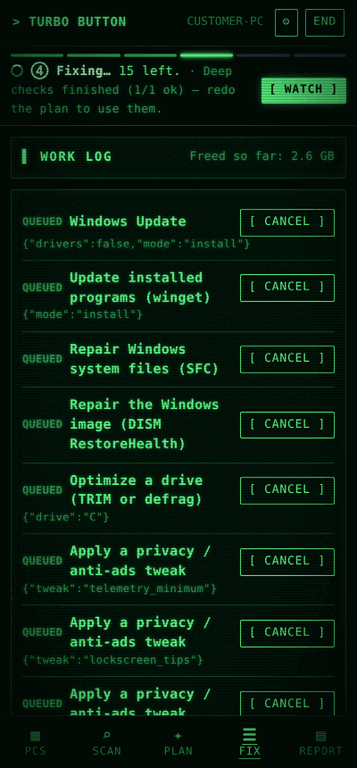 | 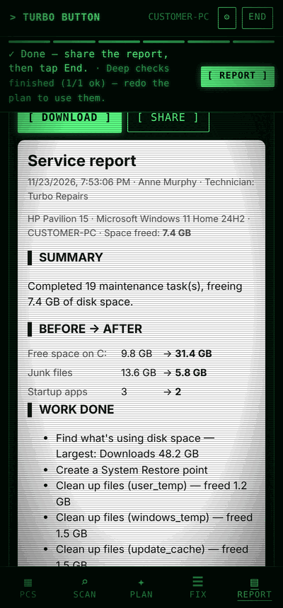 | 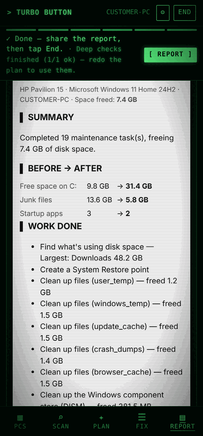 |
| Jobs run one after another. Cancel any that haven't started. | Proof of the work for the customer. | Saved on the phone. Share it by email, WhatsApp, Drive… |

**The customer screen**

| Waiting for you | Working | Done |
|:---:|:---:|:---:|
| 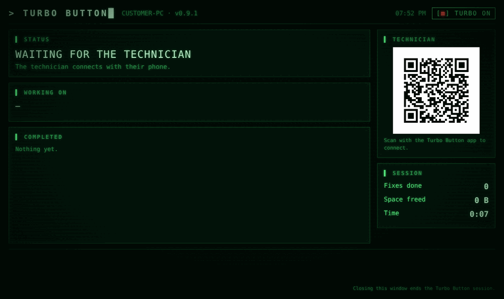 | 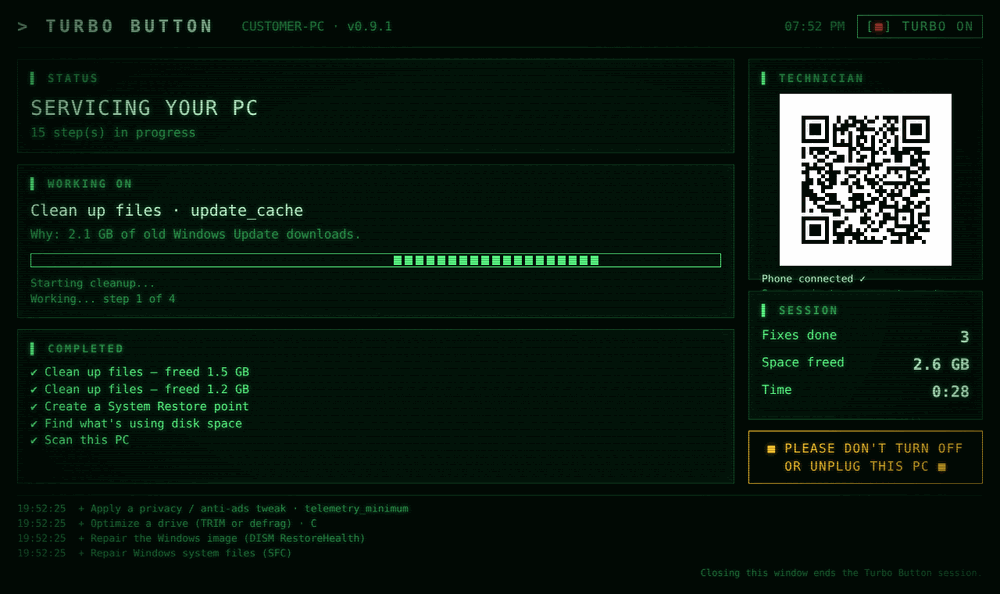 | 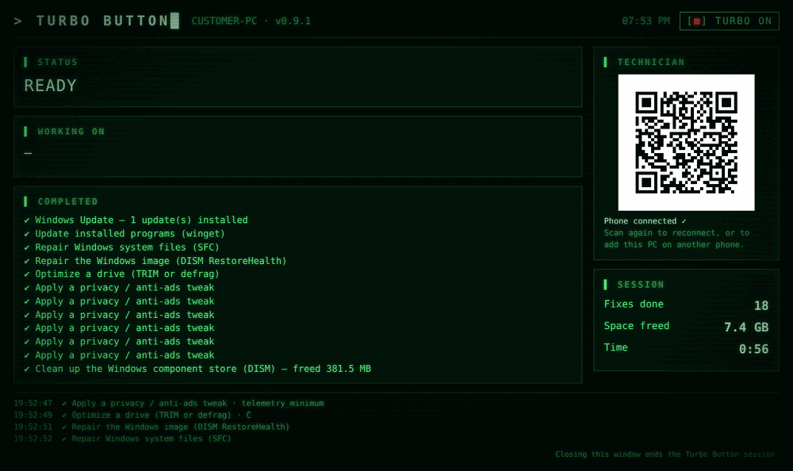 |

**Four looks** (⚙ → Look)

| Green phosphor | Amber | Deep space | Modern |
|:---:|:---:|:---:|:---:|
| 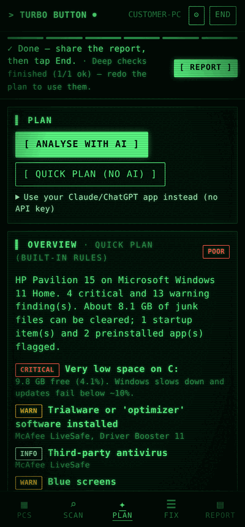 | 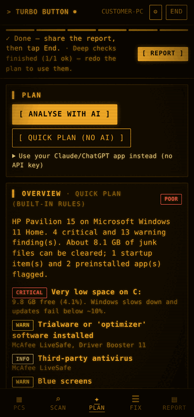 | 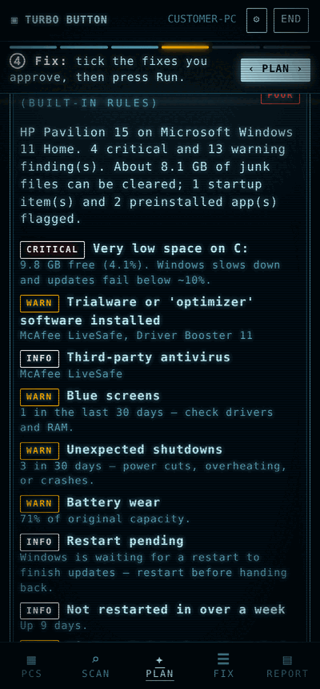 | 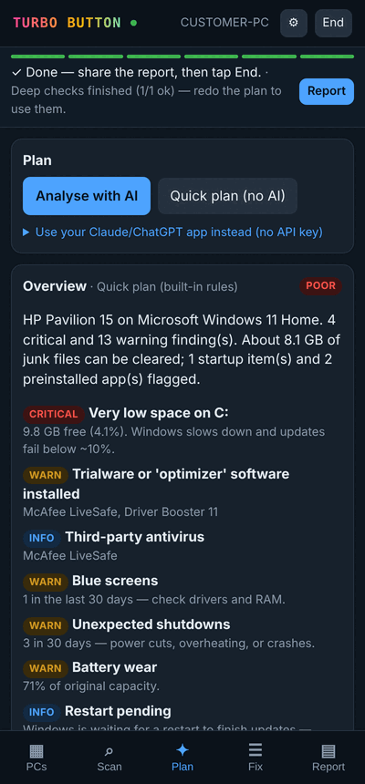 |

**The agent's console** (hidden once the customer screen opens)

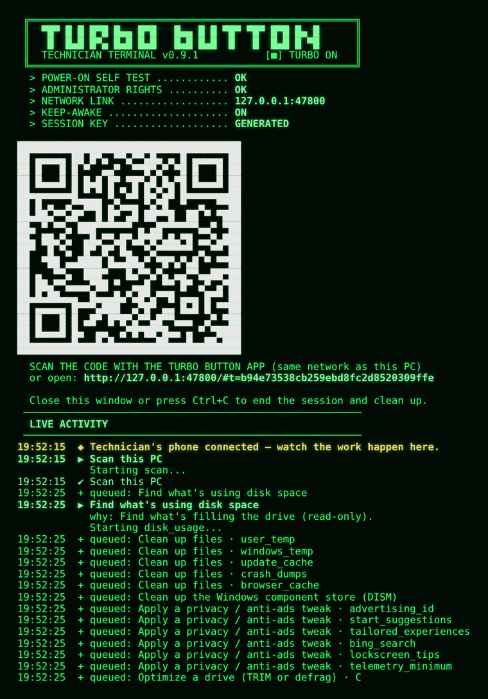

</details>

<sub>Screenshots use the built-in demo mode with made-up data. No real customer was harmed.</sub>

---

## Quick start

### 1. Get the app on your phone

1. On your phone, download [**TurboButton.apk**](https://github.com/flesheatingbug/Turbo-Button/releases/download/latest/TurboButton.apk) and open it. Allow installs from your browser when Android asks.
2. Open Turbo Button. The **⚙** screen is where you pick an AI, if you want one (see [AI options](#ai-options-free-ones-too)). Quick plan works with no setup at all.

After that the app keeps itself up to date (see [App updates](#app-updates)).

### 2. Put the agent on a USB stick

Copy these to the stick:

- [**TurboButton.exe**](https://github.com/flesheatingbug/Turbo-Button/releases/download/latest/TurboButton.exe) for Windows 10/11
- [**TurboButton-x86_64.AppImage**](https://github.com/flesheatingbug/Turbo-Button/releases/download/latest/TurboButton-x86_64.AppImage) for Linux (any distro, 64-bit Intel/AMD). There are also plain [x86_64](https://github.com/flesheatingbug/Turbo-Button/releases/download/latest/TurboButton-linux-x86_64) and [arm64](https://github.com/flesheatingbug/Turbo-Button/releases/download/latest/TurboButton-linux-arm64) binaries.

### 3. On the customer's PC

**Windows:** double-click `TurboButton.exe` and say **Yes** to the admin prompt.

**Linux:** mark it executable once (right-click → Properties → Permissions → *Is executable*, or `chmod +x`), then double-click it. The desktop's normal password prompt asks for admin rights, and the customer screen opens with the QR code. There's no terminal to keep open: **closing the customer screen ends the session**.

From a terminal it runs right there, with the QR code and live log in the terminal:

```bash
chmod +x TurboButton-x86_64.AppImage
./TurboButton-x86_64.AppImage            # or add --console to keep the log in a terminal window
```

The phone and the PC need to be on the **same network** (Wi-Fi or LAN).

### 4. Pair and go

In the app, tap **Scan QR code** and point it at the PC's screen. The scan starts by itself. Follow the step bar at the top: **Scan → Plan → Fix → Report → End**.

<details>
<summary>Command-line options</summary>

| Option | What it does |
|---|---|
| `--no-update` | Don't check GitHub for a newer build on launch. |
| `--no-screen` | Don't open the customer screen. The QR code and log stay in the console. |
| `--console` | Keep the console window visible alongside the customer screen. On Linux, a double-clicked AppImage opens a terminal for it. |

</details>

---

## What it checks and fixes

<details open>
<summary><b>🪟 Windows</b></summary>

**Scan:** hardware and drive health (SMART, SSD wear, temperature), startup speed and what's slowing it down, blue screens with their likely cause, CPU and memory pressure, temperatures, junk files, startup apps, scheduled tasks, preinstalled bloat, installed programs, antivirus and Defender status, Windows Update status, restore points, problem devices, battery wear, and browser and network hijacks (search engine, extensions, forced policies, proxy, DNS, hosts file).

**Optional deep checks** (read-only, 10–30 min): pending Windows and driver updates, outdated programs (winget), system-file and Windows-image corruption (SFC/DISM verify), file-system errors (CHKDSK online), a Defender quick scan, and what's filling the disk.

**Fixes:**

| Area | Actions |
|---|---|
| Space | Temp files, update cache, delivery optimisation, crash dumps, browser caches, thumbnails, Recycle Bin, DISM component clean-up, hibernation |
| Speed | Startup apps, scheduled tasks, services, power plan, Fast Startup, TRIM/defrag |
| Junk | Remove preinstalled Store apps, uninstall trialware and "optimizer" programs |
| Antivirus & Office | Remove any third-party antivirus (McAfee, Norton, Avast, AVG, Kaspersky, ESET, Bitdefender…): silently where possible, otherwise its own uninstaller opens on the PC. Defender takes over after a restart. Remove any Microsoft Office (2007–2016, 2019/2021/2024, Microsoft 365) silently; Outlook data is kept |
| Privacy | Advertising ID, Start menu ads and suggestions, tailored experiences, Bing in Start, lock-screen tips, minimum telemetry |
| Repair | SFC, DISM RestoreHealth, CHKDSK (scheduled), memory test, reset Windows Update, network stack, Store, search index |
| Adware | Reset proxy, DNS and hosts; remove forced browser policies |
| Security | Defender definitions update, quick/full/offline scan |
| Updates | Windows Update (optionally with drivers), update all programs via winget |
| Finish | Restart with a countdown (or cancel it) |

</details>

<details>
<summary><b>🐧 Linux</b></summary>

**Scan:** distro, kernel, desktop and package manager; drive SMART health (with smartmontools: reallocated, pending and uncorrectable sectors, NVMe wear and media errors, temperature, power-on hours); disk space; failed services; slow boot units (`systemd-analyze blame`); kernel crashes, out-of-memory kills and disk I/O errors from the journal; app crash dumps; CPU, memory, swap and temperatures; battery wear; pending updates and the last update date; autostart apps; Flatpak/Snap apps; firewall, SSH and services listening on the network; browser extensions, forced browser policies and the hosts file; Snapper/Timeshift snapshots.

**Deep checks:** pending package, Flatpak and firmware updates; disk usage; a short SMART self-test on each drive.

**Fixes:**

| Area | Actions |
|---|---|
| Safety | Snapper/Timeshift snapshot before the first change |
| Space | Package cache, journal (keeps 4 weeks/200 MB), app caches, thumbnails, crash dumps, old temp files, Trash, orphaned packages, unused Flatpak runtimes |
| Updates | pacman, apt, dnf or zypper, plus Flatpak, Snap and firmware (fwupd) |
| Speed | Disable autostart apps (by a per-user override, so the system file is untouched); restart, enable or disable services; TRIM |
| Health | SMART self-test, clear failed-service markers |
| Adware | Reset the hosts file, remove forced browser policies (backups go in `/var/lib/turbobutton/backups`) |
| Finish | DNS flush, restart with a countdown |

The app spots a Linux PC by itself and switches to Linux rules, AI instructions and deep checks.

</details>

---

## AI options (free ones too)

Choose under **⚙ → AI**. Every option is optional.

| Option | Cost | Privacy | Set up |
|---|---|---|---|
| ⚡ **Quick plan** | Free, offline | Nothing leaves the phone | Nothing: built-in rules |
| 📤 **Send to your AI app** | The Claude/ChatGPT plan you already have | Goes to your AI app | Tap the button, pick Claude or ChatGPT in the share sheet and send. On the reply, tap **Share → Turbo Button**. |
| 🏠 **Ollama** on your own server | Free | Stays on your hardware | Base `http://<server>:11434`, a model such as `qwen3.5:9b`. Away from home, reach it with Tailscale or WireGuard. |
| ✨ **Google Gemini** | Free tier (rate-limited) | Weaker free-tier data terms | Key from aistudio.google.com/apikey |
| 🔀 **OpenRouter** free models | Free (about 50 requests/day) | Free endpoints may log | Key from openrouter.ai, model `openrouter/free` |
| 🧠 **Claude / OpenAI API** | Pay per use | Provider's API terms | Key from the provider's console |

The report also has a **Basic report (no AI)** button. It builds the report from the work log and the Quick plan findings.

---

## Safety

- ✅ **Nothing happens without you.** Every change is approved on the phone, and anything risky is marked "ask the customer".
- 🛟 **Undo point first.** A restore point (Windows) or snapshot (Linux, if one is set up) is made before the first change.
- 🛡 **Security is never weakened.** It won't touch Defender, the firewall, Windows Update, UAC, core services or (on Linux) systemd, the display manager, NetworkManager, polkit or AppArmor/SELinux. Drivers and runtimes can't be uninstalled, Microsoft Defender can never be removed, and antivirus or Office removal always asks first.
- 🏢 **Business PCs are left alone.** Proxy, DNS and browser-policy resets are never proposed on domain-joined PCs.
- 💾 **Backups.** The hosts file and browser policies are backed up before they're reset.
- 🔐 **Locked to your phone.** The agent only accepts requests carrying the session key from the QR code. The customer screen only answers the PC itself.
- 🧹 **Leaves no trace.** When the session ends, the agent closes its firewall rule and deletes its temporary files.

---

## Handy extras

<details>
<summary><b>📱 Several PCs at once</b></summary>

On the **PCs** tab, tap **Scan QR code** for each PC. Each one keeps working in the background, the list shows live status, and the name in the header switches between them. Everything is saved on the phone, so closing the app loses nothing, and a PC that drops off the network reconnects by itself.

</details>

<details>
<summary><b>🔁 Restarts and coming back later</b></summary>

- **Restarts that Turbo Button starts** (Windows): it saves the session and reopens by itself after you log back in. The phone reconnects, and the before scan and work log carry on. The few files it needs while the restart is pending live in `C:\ProgramData\TurboButton` and are removed when it reopens.
- **Coming back later** (the next day, or after a restart you didn't start): run the agent again and scan the new QR code. The app recognises the PC and offers to continue the job, with the original before scan, plan, work log and report details. Unfinished jobs are kept for 14 days.

</details>

<details>
<summary><b>🖥 The customer screen</b></summary>

A full-window view on the PC in the same retro style. It shows the QR code until you connect, then what's being done and why, a progress bar, completed fixes, space freed, elapsed time, and a "please don't turn off" warning while work runs. The QR code stays up so you can reconnect, or add the PC from another phone. **Closing it ends the session** (except during a restart Turbo Button started). It needs Edge or Chrome on Windows (the console stays visible without one). On Linux it uses Chromium, Chrome, Brave, Edge or Vivaldi in an app-style window, or a tab in the default browser. If no screen can be opened when the AppImage was double-clicked, it shows an error and closes rather than running invisibly.

</details>

<details>
<summary><b>🔔 Notifications</b></summary>

With the app in the background, the phone tells you when a scan finishes, when all fixes on a PC are done (with how many failed and how much space was freed), when something needs you at the PC (like an antivirus uninstaller waiting for clicks), or when a PC drops off mid-job. While jobs run, a quiet "Working on…" notification keeps the app awake so alerts still arrive with the screen off. Turn them off under **⚙ → Notifications**.

</details>

<details>
<summary><b>⬆ Agent updates (Windows and Linux)</b></summary>

When it starts, the agent checks the Latest build on GitHub (5-second limit, so no internet just means it carries on). If there's a newer build, it downloads it, checks it against the published SHA-256 checksum, puts it in place of the old file (so the copy on your USB stick stays current) and restarts itself. If the stick is read-only, it runs the new build from a temporary copy instead. Skip it with `--no-update`.

</details>

<details id="app-updates">
<summary><b>⬆ App updates</b></summary>

The app checks the [Latest build](https://github.com/flesheatingbug/Turbo-Button/releases/tag/latest) when it opens (at most every 6 hours) and twice a day in the background, with a notification. It asks before downloading, then hands the APK to Android's installer. Turn it off or check by hand under **⚙ → App updates**. The first time, Android asks you to allow Turbo Button to install apps.

</details>

---

## Building it yourself

Every push to `main` is built by GitHub Actions. The build vets and tests the code, runs a real Linux scan, then publishes the APK, EXE, AppImage and Linux binaries to the **Latest build** release.

<details>
<summary><b>Signing key (for in-app updates)</b></summary>

The Android signing key is stored encrypted in the repo (`android/app/turbobutton.keystore.enc`). Add its passphrase once as a repository secret named `TURBO_KEYSTORE_PASS` (**Settings → Secrets and variables → Actions**). Every build is then signed with the same key, so updates install over each other. Without the secret, builds are signed with a throwaway key, and the app warns you instead of failing to install.

</details>

<details>
<summary><b>Local builds</b></summary>

```bash
# Windows agent (from any OS)
cd agent && GOOS=windows GOARCH=amd64 go build -trimpath -ldflags "-s -w" -o TurboButton.exe .

# Linux agent (static)
cd agent && CGO_ENABLED=0 go build -trimpath -ldflags "-s -w" -o turbobutton .

# Android app (needs the Android SDK)
cd android && ./gradlew assembleRelease
```

**Demo mode** (no real PC needed; this is how the screenshots were made):

```bash
cd agent && TURBO_MOCK=1 TURBO_MOCK_DELAY=1500 TURBO_MOCK_NAME=CUSTOMER-PC go run .
```

</details>

<details>
<summary><b>Project layout</b></summary>

```
agent/            Go agent: one file, no dependencies
  web/            the control page (shared by the app and phone browsers) and the customer screen
  scripts/        PowerShell scripts for Windows scans and fixes
  linux_*.go      the native Linux scan and fixes
android/          the companion app (a WebView plus a small native bridge)
packaging/linux/  AppImage launcher and desktop file
docs/media/       README screenshots and clips
```

</details>

---

## Troubleshooting

<details>
<summary><b>The phone can't connect</b></summary>

- The phone and the PC must be on the same network. Guest Wi-Fi and "client isolation" block it.
- The agent adds a firewall rule for its port (47800) itself. Third-party firewalls may still ask, or block it.
- On a VPN? Turn it off on one side, or use the address under the QR code.

</details>

<details>
<summary><b>"Couldn't read that reply" after sharing from an AI app</b></summary>

Make sure the AI replied in the chat itself, not in a canvas, artifact or file, then share that reply back. If the message says it found your own request instead of a reply, share the AI's answer rather than your prompt.

</details>

<details>
<summary><b>The update won't install</b></summary>

If the installed app was signed with a different key (builds from before the permanent key), uninstall it once and install the latest APK. Share any reports you want to keep first. Later updates install normally.

</details>

<details>
<summary><b>Linux: "Program crashed" in a terminal (builds before 0.9.2)</b></summary>

Older builds opened a terminal when double-clicked, and closing that terminal or pressing Ctrl+C killed the launcher. Update to the latest AppImage: it doesn't need a terminal, and Ctrl+C or closing one now ends the session cleanly.

</details>

<details>
<summary><b>Linux: nothing happens after the password prompt</b></summary>

Run it from a terminal (`./TurboButton-x86_64.AppImage`) to see the log. If the AppImage won't start at all, your distro may be missing FUSE 2: install `fuse2` (Arch/CachyOS) or `libfuse2` (Debian/Ubuntu), or use the plain `TurboButton-linux-x86_64` binary instead.

</details>

<details>
<summary><b>Linux: drive health says "unknown"</b></summary>

Install `smartmontools` (`pacman -S smartmontools`, `apt install smartmontools`, and so on) and rescan.

</details>

---

<div align="center">
<sub>Tested so far: the Linux agent on Ubuntu and CachyOS (KDE), the Android app on a real phone, and the Windows agent in a simulated setup. Please report anything odd on real Windows PCs.</sub>
</div>
